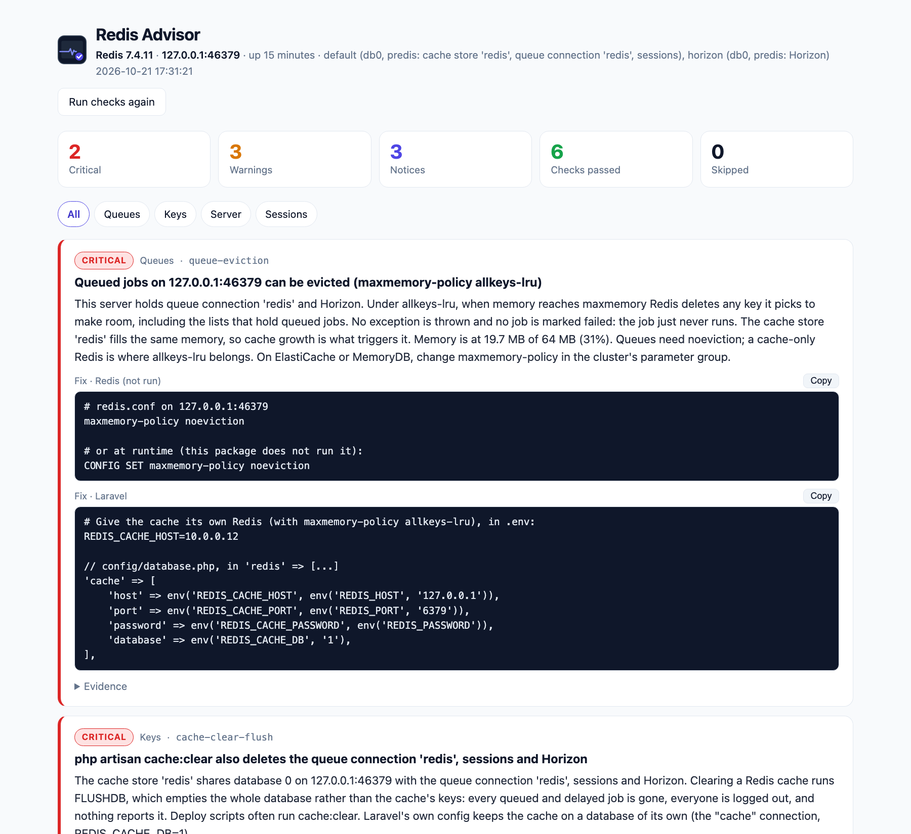

<p align="center">
  <picture>
    <source media="(prefers-color-scheme: dark)" srcset="art/banner-dark.png">
    
  </picture>
</p>

# Laravel Redis Advisor: Redis and Valkey health checks for Laravel

A read-only health advisor for the Redis (or Valkey) behind your Laravel app's cache, queues, sessions and
Horizon. It finds queued jobs that an eviction policy can silently delete, `cache:clear` wiping your queue,
keys that never expire, big keys, memory and fragmentation trouble, persistence turned off under live queues,
key prefixes shared with other apps, Horizon backlog and trimming, and session TTLs that drift from
`SESSION_LIFETIME`. For each problem it shows **the exact redis.conf line, Redis command or Laravel config that
fixes it**, as a Blade dashboard and as an artisan report that can fail CI.

It never runs a fix. Every command it sends is on a short list of reads, and you can check that list in one
place ([`ReadOnlyGuard`](src/Redis/ReadOnlyGuard.php)). It walks keys with `SCAN` in batches, never `KEYS *`.

Docs and demo: https://amjad.com.pk/laravel/packages/laravel-redis-advisor

[](https://packagist.org/packages/amjadiqbal/laravel-redis-advisor)
[](https://packagist.org/packages/amjadiqbal/laravel-redis-advisor)
[](LICENSE.md)

<p align="center">
  
</p>

```bash
composer require amjadiqbal/laravel-redis-advisor
php artisan redis-advisor:report
```

```text
  CRITICAL queue-eviction  1. Queued jobs on 10.0.0.5:6379 can be evicted (maxmemory-policy allkeys-lru)
     This server holds queue connection 'redis'. Under allkeys-lru, when memory reaches maxmemory Redis deletes
     any key it picks to make room, including the lists that hold queued jobs. No exception is thrown and no
     job is marked failed: the job just never runs. The cache store 'redis' fills the same memory, so cache
     growth is what triggers it. ...
     Fix (Redis):
       # redis.conf on 10.0.0.5:6379
       maxmemory-policy noeviction
```

## What it checks

| Area | Check | Finds |
|---|---|---|
| Queues | `queue-eviction` | Queues or Horizon on a server whose `allkeys-*` policy can delete them, worst when a cache shares it |
| | `queue-backlog` | Jobs piling up, how long the oldest has waited, reservations whose worker died |
| | `horizon-trimming` | Horizon keeping job records for days, and the shared default `laravel_horizon:` prefix |
| Keys | `cache-clear-flush` | Queues or sessions in the cache's database: `cache:clear` runs `FLUSHDB` and deletes them |
| | `cache-prefix` | Laravel's default prefixes, another app's keys in your database, two stores writing the same keys |
| | `keys-without-ttl` | `Cache::forever()` and friends, grouped by key pattern, judged against the eviction policy |
| | `big-keys` | Single keys big enough to stall Redis on every read or delete |
| Server | `persistence` | No RDB and no AOF under queues or sessions; a failed last save, which stops all writes |
| | `memory-usage` | No `maxmemory` at all, or a server close to it, and what happens when it is full |
| | `fragmentation` | Memory held but unused (with the `activedefrag` fix), or Redis partly in swap |
| | `connections` | A Redis connection the app relies on that does not answer |
| Sessions | `session-ttl` | Session keys living longer than `SESSION_LIFETIME`, sessions that never expire, sessions open to eviction |

Each finding has a severity (critical, warning or notice), the numbers it was based on, and where it applies,
the fix as Redis config or a command and in Laravel terms (`.env`, `config/*.php` or code).

## Why this package

Redis keeps almost everything you need in `INFO`, but nothing in a Laravel app reads it with Laravel in mind.
Monitoring dashboards show memory graphs. They don't tell you that your queue and your cache share a server
under `allkeys-lru`. Four Laravel-specific traps are built in:

- **A queue under `allkeys-lru` loses jobs without an error.** When memory fills, Redis deletes whichever keys
  it picks, and the list holding your queued jobs is one of them. The job never runs, never fails, and nothing
  is logged. The integration suite reproduces this on real Redis 7, Redis 8 and Valkey 8.
- **`php artisan cache:clear` runs `FLUSHDB`.** If the cache store shares a database with your queue or
  sessions, every deploy that clears the cache also deletes every queued job and logs everyone out.
- **`APP_NAME` decides your key prefixes.** Apps that never set it all write `laravel-database-queues:default`,
  so on a shared Redis they work each other's jobs.
- **Managed hosts hide settings.** ElastiCache, MemoryDB and Upstash disable `CONFIG`. The advisor reads the
  eviction policy and memory limit from `INFO`, which they all allow, and tells you exactly which checks it had
  to skip and why.

## Requirements

- PHP 8.3+
- Laravel 12 or 13
- phpredis or predis (whichever your app already uses)
- Redis or Valkey. The repository's integration suite ([`scripts/integration.sh`](scripts/integration.sh), not part of
  the Composer package) runs every check against Redis 7.4, Redis 8 and Valkey 8, each with phpredis and predis, plus
  a Redis with `CONFIG` disabled. Older servers with `INFO`, `SCAN` and `MEMORY USAGE` (Redis 4+) should work but are
  not tested.

Redis Cluster connections are not inspected. They are listed as "not inspected" in the report and the dashboard,
never as a finding, so they cannot fail a CI run. To check a cluster, add a connection to one node and list it in
`REDIS_ADVISOR_CONNECTIONS`.

## Installation

```bash
composer require amjadiqbal/laravel-redis-advisor
```

The service provider registers itself. It finds your Redis connections from your config: every `redis` cache
store, every `redis` queue connection, the session connection when `SESSION_DRIVER=redis`, and Horizon's. Two
connections are treated as the same server when Redis reports the same `run_id`, however their hosts are spelled.

To change thresholds or the list of checks, publish the config:

```bash
php artisan vendor:publish --tag=redis-advisor-config
```

### A read-only Redis user (recommended)

The advisor only reads, but the simplest proof is a user that cannot write:

```text
ACL SETUSER advisor on >a-long-password ~* resetchannels -@all +@read +info +config|get +ping +select +hello +auth +client|setname +client|setinfo
```

The last five grants are what the clients send while connecting. predis authenticates with
`HELLO … AUTH … SETNAME`, and if the user may not run `CLIENT SETNAME` the whole `HELLO` is refused.

Add connections for that user in `config/database.php` (copies of `default` and `cache` with `username` and
`password`) and list them:

```env
REDIS_ADVISOR_CONNECTIONS=advisor_default,advisor_cache
```

Anything the user or the host does not allow appears as a skipped check, with the `ACL SETUSER` grant or the
place in your provider's console where the value lives. Never as an error.

### Managed hosts and disabled commands

ElastiCache, MemoryDB and Upstash disable `CONFIG`, and some hosts refuse `MEMORY`. What that changes:

- **Eviction policy and memory limit** come from `INFO`, so `queue-eviction`, `memory-usage` and the session
  eviction notice still run.
- **`persistence`** reads a failed last save from `INFO` on every host. Whether snapshots are configured needs
  `CONFIG GET save` when AOF is off. Without it the check falls back to `INFO`: a server up for an hour or more,
  with unsaved changes and no snapshot since it started, is reported. Otherwise the check is skipped with the reason.
- **`big-keys`** is skipped when `MEMORY USAGE` is refused, with `redis-cli --bigkeys` / `--memkeys` as the way to
  check by hand. The other key checks still run.

## The dashboard

Open `/redis-advisor`. You get the findings worst first, each with a copy button for its fix, filters for
queues, keys, server and sessions, the servers and connections it looked at, plus the skipped checks with the
reason. The page has no assets to build or publish: it is one Blade view with inline CSS, in light and dark themes.

**Access.** The dashboard works in the `local` environment and returns 403 everywhere else until you
decide who may see it. Define the `viewRedisAdvisor` gate in `AppServiceProvider::boot()`:

```php
use Illuminate\Support\Facades\Gate;

Gate::define('viewRedisAdvisor', function ($user = null) {
    return $user?->email === 'you@example.com';
});
```

Keep the `= null` (or type it `?User $user`) if guests should be able to reach the callback at all. Laravel
skips a gate for guests otherwise. The gate is added after the configured middleware, so changing
`dashboard.middleware` (for example to `['web', 'auth']`) cannot remove it. Turn the dashboard off entirely
with `REDIS_ADVISOR_DASHBOARD=false`.

## The artisan report and CI

```bash
php artisan redis-advisor:report                          # everything, as text
php artisan redis-advisor:report --only=queues            # a category: queues, keys, server, sessions
php artisan redis-advisor:report --only=queue-eviction    # or a single check id (repeat or comma-separate)
php artisan redis-advisor:report --format=json            # for scripts and dashboards
php artisan redis-advisor:report --connection=cache       # only these Redis connections
```

Exit codes:

| Code | Meaning |
|---|---|
| `0` | No finding at or above `--fail-on` |
| `1` | At least one finding at or above `--fail-on` (default `critical`; also `warning`, `notice`, `never`) |
| `2` | Nothing could be inspected: no Redis connection answered, the app does not use Redis, or its only Redis connections are clusters |
| `2` | An invalid option, such as `--fail-on=sometimes` |

When only some connections fail, the run does not exit 2. Each one that did not answer becomes a `connections`
finding: critical when it holds queues, sessions or Horizon, a warning otherwise, so `--fail-on` decides. Cluster
connections are only listed as not inspected and never affect the exit code.

The config checks run well in a deploy pipeline, against the app's real config:

```bash
php artisan redis-advisor:report --only=queue-eviction,cache-clear-flush,persistence --fail-on=critical
```

The usage checks (backlog, keys, memory) mean most on a server with real traffic, so run them on a schedule:

```php
// routes/console.php
Schedule::command('redis-advisor:report --fail-on=warning')->hourly()->emailOutputOnFailure('ops@example.com');
```

## Reading the findings with care

- **Key checks sample.** `keys-without-ttl`, `big-keys` and `cache-prefix` share one sample per database: up to
  `sample_keys` (10,000) keys walked with `SCAN`, with counts scaled up to the whole database. Each finding says how
  many keys it saw. `redis-cli --bigkeys` and `--memkeys` scan everything if you need certainty.
- **`session-ttl` samples on its own.** It walks only session keys (`SCAN MATCH` on the session prefix, up to
  `sample_keys`), reads their `PTTL`, and reports the counts it saw without scaling.
- **Sampling does not disturb eviction.** For each sampled key it sends `PTTL` and `MEMORY USAGE … SAMPLES 5`,
  pipelined per `SCAN` page. `TYPE` is read only for the big keys it reports. Redis does not count any of these
  as an access, so sampling does not change which keys an LRU or LFU policy evicts.
- **One server is one opinion.** On a primary with replicas, run the report against each one you rely on.

## Configuration

`config/redis-advisor.php`:

- `connections`: Redis connection names to inspect (default: every one the app uses)
- `dashboard.enabled`, `dashboard.path`, `dashboard.domain`, `dashboard.middleware`
- `checks`: the list of check classes. Remove one to switch it off.
- `ignore_keys`: raw key names or shell patterns that the key checks never report on
- `thresholds`: every number a check compares against, each with a comment

### Your own check

Implement `AmjadIqbal\RedisAdvisor\Checks\Check` and add the class to `checks`:

```php
use AmjadIqbal\RedisAdvisor\Category;
use AmjadIqbal\RedisAdvisor\Checks\Check;
use AmjadIqbal\RedisAdvisor\Checks\Thresholds;
use AmjadIqbal\RedisAdvisor\Finding;
use AmjadIqbal\RedisAdvisor\Redis\Topology;
use AmjadIqbal\RedisAdvisor\Severity;

final class ClientCount implements Check
{
    public function id(): string { return 'client-count'; }
    public function title(): string { return 'Connected clients'; }
    public function category(): Category { return Category::Server; }

    public function run(Topology $redis, Thresholds $thresholds): array
    {
        $findings = [];

        foreach ($redis->servers() as $server) {
            $clients = (int) ($server->info()['connected_clients'] ?? 0);

            if ($clients > 5000) {
                $findings[] = new Finding(
                    check: $this->id(), category: $this->category(), severity: Severity::Warning,
                    subject: $server->server()->address, title: "{$clients} clients connected",
                    detail: 'Something is opening connections and not closing them.',
                );
            }
        }

        return $findings;
    }
}
```

`$server->command()` refuses anything that is not a read. If your check throws `CheckUnavailable`, it is
reported as skipped with your reason. Any other exception is reported as a skipped check with its message.
Either way, one broken check never breaks the report or the dashboard.

## Testing

```bash
composer test                # unit and feature tests
scripts/integration.sh       # real Redis 7, Redis 8, Valkey 8 and a CONFIG-less Redis in Docker, predis and phpredis:
                             # every check fires on a real problem (a job really lost to eviction), then clears
scripts/ci-local.sh          # PHP 8.3-8.5 x Laravel 12-13, Pint, PHPStan, then the integration run
```

## Need this built into your app, or something custom?

I tune Redis-backed Laravel apps, from queues that lose jobs and Horizon setups to cache and session design,
and I build Laravel packages. If you would rather have someone go through these findings with you, or you need
something this package does not do,
[get in touch](https://amjad.com.pk/contact?utm_source=github&utm_medium=readme&utm_campaign=laravel-redis-advisor).

## Support

- 🐛 **Bug or feature request**: [open an issue](https://github.com/amjadiqbal/laravel-redis-advisor/issues)
- 🔒 **Security issue**: please report privately via GitHub's security tab

## Need this customised, or something built?

I'm available for custom development, package integration, and technical consulting.

[](https://www.upwork.com/freelancers/amjadkhatri)

## More packages

Part of a family of open-source packages. See [all of them](https://github.com/amjadiqbal?tab=repositories).

| | |
|---|---|
| [laravel-mysql-advisor](https://github.com/amjadiqbal/laravel-mysql-advisor) | Read-only MySQL and MariaDB health checks with the fix SQL |
| [kiln](https://github.com/amjadiqbal/kiln) | Deploy-time OPcache control for Laravel |
| [refresher](https://github.com/amjadiqbal/refresher) | Cache your test DB schema, skip `migrate:fresh` on every test run |
| [laravel-driver-js](https://github.com/amjadiqbal/laravel-driver-js) | Product tours and onboarding for Laravel |

## Changelog

See [CHANGELOG.md](CHANGELOG.md).

## License

MIT. See [LICENSE.md](LICENSE.md). Redis is a registered trademark of Redis Ltd. and Valkey is a project of the
Linux Foundation; this package is independent and not affiliated with either.
