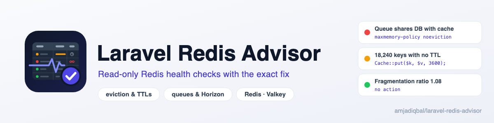

  <picture>
    <source media="(prefers-color-scheme: dark)" srcset="art/banner-dark.png">
    
  </picture>

# Laravel Redis Advisor

A read-only health advisor for the Redis (or Valkey) server behind your Laravel app. It finds a
queue sharing a database with the cache under an `allkeys-*` eviction policy, keys with no TTL, big
keys, memory and fragmentation trouble, persistence turned off under live queues, cache prefix
collisions, Horizon backlog and session TTLs that don't match `SESSION_LIFETIME`, and shows the
exact config line or command to fix each one. It never runs a fix itself.

> **Status:** in development. The first release is not on Packagist yet.

## Support

- 🐛 **Bug or feature request**: [open an issue](https://github.com/amjadiqbal/laravel-redis-advisor/issues)
- 🔒 **Security issue**: please report privately via GitHub's security tab

## Need this customised, or something built?

I'm available for custom development, package integration, and technical consulting.

## License

MIT. See [LICENSE.md](LICENSE.md). Redis is a registered trademark of Redis Ltd. and Valkey is a
project of the Linux Foundation; this package is independent and not affiliated with either.
